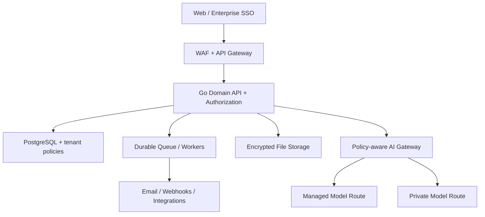

# TaskForce V3.0 — Enterprise Implementation Blueprint

**Document type:** Product Requirements Document (PRD) + Technical Architecture + Delivery Specification  
**Status:** Proposed baseline for product-owner and engineering review  
**Date:** 30 October 2026  
**Product:** TaskForce — AI-Powered Unified Work Command Center  
**Launch segment:** Large enterprises  
**AI deployment decision:** Hybrid AI (managed model gateway plus eligible private/self-hosted model routes)  
**Current asset:** Projectly/TaskForce V0.2 interactive browser prototype with 10 screens, personal and fictional company demo data; **not** production SaaS.

> **Decision statement:** This is a proposed implementation specification, not an assertion that the listed services exist today. Features marked P0/P1/P2 are planned. All enterprise security, compliance, AI, and availability claims must be verified in design review, threat modeling, testing, and procurement review before launch.

## 1. Executive summary

TaskForce is a multi-tenant, multiuser, multi-role SaaS that unifies a user's **private personal work**, **authorized enterprise work**, and **leadership intelligence**. An organization creates departments, teams, projects, tasks, milestones and workflows. An individual can simultaneously belong to several organizations while maintaining a strictly private personal workspace. Leaders see role-authorized portfolios, workforce capacity and risk signals. A hybrid AI layer produces grounded work summaries, actionable suggestions and progressively better forecasts. Future email and API integrations bring approved external work into TaskForce.

**Core promise:** Plan smarter. Execute faster. Lead better.  
**Design principle:** One interface; explicit data boundaries. A combined personal view is **not** permission for employer access to private tasks, emails, or other tenants.

### 1.1 Enterprise launch constraints

1. SSO and strong authentication are baseline, not add-ons; support enterprise OIDC at launch, determine SAML and SCIM timing with pilot buyers.
2. Enforce tenant and resource-level authorization on every backend call and database query; test negative access cases continuously.
3. Retain auditable change history, export controls, configurable retention and a documented privacy/security operating model.
4. Deliver a meaningful **read-only executive AI summary** and deterministic alerting in P0; do not advertise statistically validated forecasts until sufficient labeled history exists.
5. Avoid promising a complete HRMS, full email client, cross-application orchestration or broad industry coverage in Release 1.

## 2. Product outcomes, personas and jobs to be done

| Persona | Main job | Success outcome |
|---|---|---|
| Professional/member | Track my private work and authorized assignments | No missed priority, clear due-date view |
| Team lead | Coordinate people and remove blockers | Lower unowned and delayed work |
| Project manager | Plan and deliver scoped project | Forecastable milestones and accurate activity history |
| Department head | Balance resources across teams | Visible workload and intervention points |
| Executive/PMO | Review authorized cross-portfolio health | Trustworthy, drill-down-ready executive reports |
| Tenant/IT administrator | Provision users and govern access | Controlled membership, policies, audit evidence |
| Security/privacy officer | Validate controls and investigation trail | Tenant isolation, retention, AI/data governance |
| Integration developer | Connect enterprise systems | Documented scoped APIs and reliable events |

### 2.1 Initial success metrics (proposed; validate with pilots)

- Activation: share of invited users who complete a task or project action in seven days.
- Weekly engaged teams: teams that update tasks and review a board weekly.
- Reporting efficiency: reduction in manual weekly status-report preparation time, measured in pilot studies.
- Data quality: tasks with owner, due date and valid status; share of stale tasks.
- Risk response: median time from an actionable high-risk alert to owner acknowledgment.
- Reliability/security: availability and latency against agreed SLOs; zero accepted cross-tenant data exposure.
- AI: grounded-answer quality, false-positive alert rate, citation/source coverage, human override rate.
- Guardrail: do **not** score employee value by raw task volume alone.

## 3. Scope and prioritization

**P0 — Enterprise pilot MVP:** identity/SSO; tenant and personal workspace isolation; admin-managed memberships and scoped roles; projects, tasks, task boards, milestones, comments and attachments; department/team membership; calendars for due dates; executive metrics; CSV exports; notifications and rules-based alerts; audit trails; tenant settings; AI read-only summaries behind policy controls; backups and observability.

**P1 — Extended enterprise:** SAML/SCIM as enterprise demand dictates; workload estimates/capacity; advanced templates/custom fields/approvals; hiring requests and interview/onboarding workflows with HR-specific permissions; connected Gmail and Microsoft 365 email read/view and reviewed email-to-task conversion; webhooks and documented developer APIs; configurable workflow rules; advanced report scheduling.

**P2 — Expansion:** predictive delivery models backed by validated history; advanced AI agents with human approval; bidirectional mail/calendar sync; full email compose/send experience if justified; broad application marketplace; industry-specific packs; optional dedicated tenant infrastructure and private AI serving; extended workforce/skills features.

**Explicitly out of P0:** complete ATS/HRMS, payroll, AI auto-sending email, unrestricted AI database access, unreviewed AI task reassignment, custom LLM foundation-model training, mobile-native app, replacement for Outlook/Gmail, and broad customer-specific integrations.

### 3.1 Current prototype versus intended SaaS

The existing browser demo has 10 navigable screens; create/edit personal and company projects/tasks; basic team workload and Kanban; reporting and CSV; browser-local preferences. It uses localStorage and synthetic samples. It does **not** implement tenant provisioning, login, backend authorization, actual team creation/membership, SSO, AI, integrated email, or external APIs. Some demo health/progress values and date computations are fixed. Replace these with server-side definitions and real-time clock/configured timezone in the production application.

## 4. Full module and submodule hierarchy

```text
TaskForce SaaS
├── PERSONAL
│   ├── 01 Personal Dashboard — Today, priorities, personal KPIs, assigned work preview
│   ├── 02 My Work — cross-authorized queue, owner actions, filters, saved views
│   ├── 03 My Calendar — task deadlines, planned events, connected calendar later
│   └── 04 Personal Projects — private projects, tasks, goals, notes, milestones
├── EXECUTION & PEOPLE
│   ├── 05 Projects & Tasks — portfolios, projects, milestones, lists, dependencies, files
│   ├── 06 Kanban Task Boards — workflow columns, swimlanes, drag/drop, WIP policies
│   ├── 07 Teams & Workload — departments, teams, memberships, assignment/capacity
│   └── 08 Team Development & Hiring — requests, interviews, onboarding, skills, learning
├── LEADERSHIP & INTELLIGENCE
│   ├── 09 Executive Dashboard — scoped portfolio, health, blockers, capacity
│   ├── 10 Reports & Insights — filters, saved reports, exports, scheduled distribution
│   └── 11 AI Intelligence Center — Q&A, grounded summaries, risk findings, approvals
├── COMMUNICATION & WORKFLOW
│   ├── 12 Email & Communication Hub — connected accounts, threads, reviewed email-to-task
│   └── 13 Automations & Alerts — rules, reminders, escalations, notification channels
└── PLATFORM
    ├── 14 API & Integrations — apps, OAuth connections, API clients, webhooks, logs
    └── 15 Settings & Administration — orgs, users, roles, security, AI policy, audit, billing
```

### 4.1 Core task object

`task_id`, `workspace_id`, `org_id` (only organization-owned work), `project_id`, `parent_task_id`, `title`, `description`, `status`, `priority`, `owner_user_id`, `creator_user_id`, `assignee_user_ids` (if business policy permits multiple assignees), `team_id`, `due_at`, `start_at`, `estimate_minutes`, `completed_at`, `blocked_reason`, `custom_fields`, `version`, `created_at`, `updated_at`, `deleted_at` (soft delete). Tasks may have checklist items, comments, attachments and dependency links. Prefer a single accountable owner with additional collaborators rather than ambiguous joint accountability.

### 4.2 Task lifecycle

Default: `To Do → In Progress → In Review → Done`, with `Blocked` entered from active states and returned after resolution. Also support `Cancelled` as a distinct terminal state. Enterprise admins may configure permitted transitions; the server enforces transitions. Reopening a task produces an audit event. Completion metrics exclude cancelled records from the eligible denominator by default; report definitions explicitly declare their rules.

## 5. Identity, tenancy and authorization

### 5.1 Tenancy model

- **Global user identity:** an identity can have zero or more organization memberships.
- **Personal workspace:** owned by one user; no implicit organization membership or enterprise read access. A future explicit sharing capability requires separate consent and policy.
- **Organization/tenant:** legal/workspace boundary with region, plan, policies and lifecycle.
- **Department/team/project:** nested business context, not necessarily a separate security tenant.
- **Membership:** status, invitation lifecycle and scoped role binding; suspended identities cannot use existing sessions.
- **External guest:** explicit guest membership to a limited project, with expiry and external-domain policy.
- **Multiple organizations:** active tenant context is selected explicitly; switching context changes authorized queries but not privileges.
- **Control plane vs data plane:** platform support/admin services should not silently gain customer-data reading rights; use audited break-glass with approval and expiration.

### 5.2 Role types and permission matrix

Legend: **F** full within own scope; **M** manage delegated scope; **R** read authorized scope; **O** own/assigned only; **—** denied by default. Every cell is additionally conditioned on resource membership and policy; roles do not bypass cross-tenant isolation.

| Role | Tenant users & policy | All-tenant projects | Assigned projects/tasks | Executive reports | Hiring details | API/AI policy | Private personal items |
|---|---|---|---|---|---|---|---|
| Platform operator | — (support workflow only) | — | — | — | — | Infrastructure only | — |
| Tenant owner | F | F (unless confidential exception) | F | F | R by separately granted HR scope | F | Own only |
| Org admin | F | M | M | R | — unless HR permission | M | Own only |
| Executive / PMO | — | R in authorized portfolio | R | R | — | — | Own only |
| Department head | — | M in department | M in department | R in department | Delegated only | — | Own only |
| Project manager | — | — | M in assigned projects | R in assigned projects | — | — | Own only |
| Team lead | — | — | M in assigned team | R in team | — | — | Own only |
| Member | — | — | O (plus explicitly shared) | O/self reports | — | — | Own only |
| Viewer/auditor | — | — | R in granted scope | R in granted scope | Explicit only | — | Own only |
| HR specialist | — | — | R in hiring scope | HR-only dashboards | M in hiring scope | — | Own only |

**Platform Super Admin** manages deployments, subscriptions and service operations but is not a universal customer-data reader. Define an audited support/break-glass process if operational access is necessary.

### 5.3 Authorization implementation

1. Authenticate via standards-based IdP; validate issuer, audience, signature, expiry and account state.
2. Resolve requested tenant/workspace and authenticated membership; never trust a client-supplied tenant header as proof.
3. Evaluate action + resource + membership + project/department scope with centralized server policy.
4. Apply storage-level isolation (e.g., database row-level policies) as defense in depth; test connection-pool context reset, bypass roles, jobs, exports and joins.
5. Apply the same authorization to background jobs, file downloads, reports, search, AI retrieval, logs, caches, webhooks and API keys.
6. Deny by default; audit significant privilege and membership changes.

### 5.4 Example permission claims

`org.members.invite`, `org.policy.manage`, `project.create`, `project.read`, `project.update`, `project.archive`, `task.create`, `task.assign`, `task.update`, `team.manage`, `report.read`, `report.export`, `hiring.manage`, `email.connect`, `integration.manage`, `ai.query`, `ai.manage_policy`, `audit.read`.

## 6. Critical user journeys and acceptance criteria

| Journey | Core steps | Release | Acceptance |
|---|---|---|---|
| A. Enterprise onboarding | SSO → admin creates tenant → configures policy → invites users | P0 | All users have exactly scoped org membership; audit entry created |
| B. Personal vs org | User creates private task → receives org assignment → opens My Work | P0 | Both appear to user; private item never appears in org reports |
| C. Project delivery | Manager creates project → milestone → task → assignee → status updates | P0 | Board, detail, metrics and reports converge after refresh |
| D. Access isolation | User with memberships A/B switches active tenant | P0 | No unauthorized result, cache entry, attachment or AI citation leaks |
| E. Executive review | Executive filters portfolio → drills into delayed task → delegates follow-up | P0 | Every drill-down is independently authorized; KPIs match underlying data |
| F. AI briefing | Executive requests weekly summary → approved context retrieved → structured answer | P0 | Source links; scope, model route and request logged; no auto-action |
| G. Staffing | Manager creates hiring request → interviews → onboarding tasks | P1 | Candidate data visible only to appropriately scoped HR participants |
| H. Email-to-task | User authorizes mailbox → selects thread → reviews generated task → confirms | P1 | Email scope and source linkage retained; no automatic external send |
| I. External API | Admin creates scoped API client → integration creates task → webhook sends event | P1 | Idempotent create; signed webhook; unauthorized endpoint returns denial |
| J. Predictive risk | Model evaluates history → reports risk/confidence → manager reviews | P2 | Evaluated calibration/precision and override tracked; no fabricated certainty |

## 7. SaaS architecture

### 7.1 Recommended stack

| Layer | Choice | Rationale |
|---|---|---|
| Web client | Next.js + React + TypeScript | Role-aware UI, reusable screen components |
| API / business domain | Go modular monolith initially | Strong fit with existing Go expertise; clear domain boundaries |
| Primary database | Managed PostgreSQL | Transactions, relational authorization, mature operational ecosystem |
| Cache | Redis | Scoped cache, temporary state, rate limits; never authorization source of truth |
| Background workers | Durable queue + Go workers | Reminders, exports, mail sync, webhooks, AI jobs |
| Search | PostgreSQL full-text initially | Avoid early search infrastructure; upgrade by measured need |
| Object storage | Encrypted S3-compatible store | Attachments/exports with signed URLs and scanning |
| Identity | Enterprise OIDC/SAML-capable IdP | SSO, MFA, tenant identity federation |
| AI gateway | Model-agnostic service in Go/Python | Managed + private route with policy enforcement |
| AI knowledge retrieval | Scoped document store/vector extension | Only permission-filtered chunks; evidence links |
| Deployment | Managed containers + IaC + CI/CD | Production control without premature microservice proliferation |
| Telemetry | Metrics, logs and traces | Performance, cost, incident investigation and audit |

### 7.2 Logical topology



**Domain packages:** identity, organizations, memberships, workspaces, projects, tasks, calendar, people, hiring, reporting, notifications, integrations, AI, audit and billing. Each module owns APIs/events; extract a microservice only if scaling, security isolation or team ownership makes it worthwhile.

### 7.3 Data-isolation options

- **Initial shared service:** pooled PostgreSQL with `tenant_id` on organization records, compound constraints and database row-level security; separate explicitly user-owned personal records/workspaces. Application checks remain mandatory.
- **Advanced enterprise tier:** selectively offer dedicated database/schema or dedicated deployment per tenant after operational, cost and contract review. This is an optional isolation tier, not a substitute for authorization.
- **Region policy:** location of customer data, backup, AI processing and email synchronization decided by contract and customer settings; do not promise specific residency without deploying/verifying it.

### 7.4 Cross-cutting data rules

- UTC timestamps at rest; user/tenant configured timezone for display, due dates, notifications and overdue calculations.
- Soft deletes for recoverable task/project records; policy-controlled hard deletion and retention jobs for legal/contractual obligations.
- Optimistic concurrency on edits using `version`/ETag; resolve concurrent updates explicitly.
- Idempotent job handlers and delivery retries; append-only audit event for high-value changes.
- Every cache key, analytics aggregate, export and search index is scoped to authorized tenant/workspace.
- Private workspace data does not enter enterprise reports, AI context or tenant exports.

## 8. Hybrid AI architecture and product specification

### 8.1 Definition of hybrid AI

**Managed route:** approved externally hosted model via an enterprise-controlled gateway and contract-appropriate data handling.  
**Private route:** tenant-approved private/self-hosted inference for customers needing controlled execution.  
**Rules route:** deterministic business logic for due dates, WIP thresholds, blocked tasks, elapsed time and other objective conditions.  

One tenant's route must not change another tenant's settings or expose cross-tenant prompts or retrieval data.

### 8.2 AI request lifecycle

1. Authenticated user requests a summary, answer or recommendation.
2. Determine `actor_id`, `tenant_id`/personal context, resource scopes and approved AI policy.
3. Query authorized structured records and permission-filtered document chunks; omit secrets and unnecessary personal data.
4. Build prompt with clear instructions, untrusted-data boundaries and source IDs.
5. Route to eligible model; enforce provider, region, retention and budget rules.
6. Validate output schema and citations; flag uncertainty; reject unsupported actions.
7. Store minimal permitted audit/usage metadata, not indiscriminate full prompts or email bodies.
8. Display grounded explanation and human-reviewable suggested next steps.

### 8.3 AI capability priority

| AI function | First implementation | Later upgrade |
|---|---|---|
| Deadline alerts | Deterministic rule based on timezone and due date | Learned probability of delay |
| Blocker alerts | Status + duration + dependencies | Root-cause pattern detection |
| Workload alerts | Open estimated effort versus capacity threshold | Forecast capacity and risk |
| Executive summary | Retrieval-grounded read-only generated briefing | Scheduled, cited trend narrative |
| AI natural-language Q&A | Scoped query templates and cited records | More flexible analysis with constrained tool calls |
| Email-to-task | User selects a thread and approves draft fields | Suggested extraction and triage |
| Auto actions | None in P0 | Approval-gated workflows with per-action scopes |

### 8.4 AI controls and measurement

- Threats: prompt injection in emails/attachments, data exfiltration, hallucinations, insecure tool use, unauthorized cross-tenant retrieval, model/provider failures.
- Controls: scoped retrieval and independent authorization on every tool call; output filtering; no arbitrary SQL or filesystem access; egress allowlists; cost/rate budgets; versioned prompts/evaluations; provider route policy; human confirmation for external communications or writes.
- Metrics: grounded-answer pass rate, source traceability, inappropriate disclosure incidents, alert precision/recall, latency, per-tenant token spend, fallback rate, user overrides and prediction calibration.
- **No training pledge:** default to no customer-data training; record explicit contractual consent and deletion implications for any future fine-tuning.

## 9. Data model / database specification

The following is a conceptual schema. Use UUID/ULID or comparable opaque IDs; choose one standard. All organization-owned rows carry `tenant_id` and storage-level policies. Composite foreign keys prevent cross-tenant relationships, including on join tables.

| Entity | Principal fields / relationships | Key invariants |
|---|---|---|
| `users` | id, email, display_name, timezone, state | Global identity; not the tenant |
| `identity_links` | user_id, issuer, subject, provider | Unique issuer/subject; SSO identities |
| `organizations` | id, slug, region, status, plan_id | Organization boundary |
| `org_memberships` | org_id, user_id, state, joined_at | Unique organization/user |
| `roles` | id, org_id?, key, permission_set | System and tenant-defined roles |
| `role_bindings` | user_id, org_id, scope_type, scope_id, role_id | Scoped, auditable grants |
| `workspaces` | id, kind, org_id?, owner_user_id? | `PERSONAL` xor `ORG`; owner or tenant required |
| `departments` | id, tenant_id, head_user_id, name | Scoped within organization |
| `teams` | id, tenant_id, department_id?, name | Scoped organization hierarchy |
| `team_memberships` | team_id, user_id, tenant_id, role | Org membership prerequisite |
| `portfolios` | id, tenant_id, owner_user_id, name | Group authorized projects |
| `projects` | id, workspace_id, tenant_id?, code, owner_id, state, health | Personal/tenant ownership consistent |
| `project_memberships` | project_id, user_id, access_level | Explicit access or derived department policy |
| `milestones` | id, project_id, target_at, state | Project-scoped |
| `tasks` | id, project_id, workspace_id, tenant_id?, owner_id, status, due_at, version | Cross-scope foreign keys prevented |
| `task_assignees` | task_id, user_id, responsibility | User must be authorized in scope |
| `task_dependencies` | task_id, depends_on_task_id, type | No self/circular dependency |
| `task_comments` | id, task_id, author_id, body | Secure rich text and audit |
| `task_checklists` | id, task_id, text, checked | Task-scoped |
| `attachments` | id, owner_resource, storage_key, classification | Authorized download, malware scan |
| `calendar_events` | id, workspace_id, owner_id, starts_at, ends_at | Visibility by workspace and participant |
| `notifications` | id, recipient_id, event_type, read_at | Sender visibility separate from recipient |
| `automation_rules` | id, tenant_id?, condition, action, state | Scoped rule executor and approval |
| `audit_events` | id, tenant_id?, actor_id, action, target, timestamp, trace_id | Tamper-evident retention policy |
| `report_definitions` | id, tenant_id?, scope, metrics, filters | Report owner and permission schema |
| `report_jobs` | id, definition_id, actor_id, state, file_id | Reauthorize at generation and download |
| `hiring_requests` | id, tenant_id, team_id, position, approval_state | HR visibility boundaries |
| `candidates` | id, tenant_id, minimal PII, retention_at | Stricter HR policy and deletion |
| `interviews` | id, candidate_id, schedule, interviewers, feedback_policy | Interview-specific access |
| `connected_accounts` | id, user_id, tenant_id?, provider, encrypted_token_ref | No plaintext refresh token in app DB |
| `message_references` | id, connection_id, provider_msg_id, task_id? | Metadata first; retention controls |
| `api_clients` | id, tenant_id, scopes, credential_hash, state | Scoped credentials, rotation |
| `webhook_subscriptions` | id, tenant_id, endpoint, events, secret_ref | HTTPS, signing, retries |
| `integration_events` | id, tenant_id, source, event_id, processing_state | Idempotent ingress |
| `ai_requests` | id, actor_id, tenant_id?, model_route, purpose, usage | Minimized and policy-scoped logging |
| `ai_findings` | id, tenant_id?, target_ref, severity, evidence, reviewer_state | Findings are advisory with source links |
| `billing_accounts` | id, organization_id, subscription_ref | Segregated commercial records |

### 9.1 Essential schema constraints and indexes

- `org_memberships (org_id, user_id)` unique; role binding scope validated on every change.
- `tasks (tenant_id, project_id, status, due_at)` and `(workspace_id, owner_id, due_at)` indexes matched to real query patterns; include partial indexes as usage justifies.
- `project_memberships`, `team_memberships` and all resource joins must enforce matching tenant IDs.
- `task_dependencies` graph cycle validation at service transaction boundary.
- `api_clients` store hashes/secrets references, never raw reusable API secrets.
- Hard constraints, row policies and automated test fixtures enforce `PERSONAL` ownership and `ORG` membership isolation.
- Database migrations must include backfill, rollback/forward plans and index-lock impact review.

## 10. API and integration plan

### 10.1 API contract principles

- Base route: `/api/v1`; publish OpenAPI 3.1 contract and generated client SDKs later.
- HTTPS, authenticated bearer tokens; API credentials are scoped to a tenant and independently rate limited.
- Use explicit resource paths, stable opaque IDs, cursor pagination, filters, validation and request IDs.
- `Idempotency-Key` supported for create/invite/issue commands that may be retried.
- `If-Match` or version for concurrent updates; return `409`/`412` on conflict.
- Uniform error: `code`, `message`, `request_id`, optional `field_errors`; suppress sensitive backend detail.
- Audit sensitive changes, enforce authorization and quotas, classify PII; have retention and API deprecation policy.

### 10.2 Initial endpoints

| Domain | Method and route | Purpose | Priority |
|---|---|---|---|
| Identity | `GET /api/v1/me` | Profile, active memberships and settings | P0 |
| Organizations | `POST /api/v1/organizations` | Create tenant with policy | P0 |
| Organizations | `GET /api/v1/organizations/{orgId}` | Authorized tenant detail | P0 |
| Memberships | `POST /api/v1/organizations/{orgId}/invitations` | Invite scoped member | P0 |
| Memberships | `PATCH /api/v1/organizations/{orgId}/members/{userId}` | Change membership state/role | P0 |
| Departments | `GET/POST /api/v1/organizations/{orgId}/departments` | Department catalog | P0 |
| Teams | `GET/POST /api/v1/organizations/{orgId}/teams` | Teams and memberships | P0 |
| Workspaces | `GET /api/v1/workspaces` | Personal + authorized org workspaces | P0 |
| Projects | `GET/POST /api/v1/workspaces/{workspaceId}/projects` | Scoped list/create | P0 |
| Projects | `GET/PATCH /api/v1/projects/{projectId}` | Detail and authorized change | P0 |
| Tasks | `GET/POST /api/v1/projects/{projectId}/tasks` | Filter/list/create | P0 |
| Tasks | `GET/PATCH /api/v1/tasks/{taskId}` | Detail and status/edit | P0 |
| My Work | `GET /api/v1/me/work-items` | Union of personal + authorized assignments | P0 |
| Boards | `GET /api/v1/projects/{projectId}/board` | Board state and WIP | P0 |
| Reports | `POST /api/v1/report-jobs` | Create authorized export job | P0 |
| Reports | `GET /api/v1/report-jobs/{jobId}` | Status + authorized download reference | P0 |
| AI | `POST /api/v1/ai/briefings` | Scoped, read-only generated summary | P0 |
| Notifications | `GET /api/v1/me/notifications` | Recipient notifications | P0 |
| Audits | `GET /api/v1/organizations/{orgId}/audit-events` | Scoped security/audit review | P0 |
| Hiring | `POST /api/v1/organizations/{orgId}/hiring-requests` | Hiring workflow | P1 |
| Email | `POST /api/v1/email/connections` | Begin provider OAuth flow | P1 |
| Email | `POST /api/v1/email/task-drafts` | Reviewable email-to-task draft | P1 |
| API clients | `POST /api/v1/organizations/{orgId}/api-clients` | Scoped developer integration | P1 |
| Webhooks | `POST /api/v1/organizations/{orgId}/webhooks` | Subscriptions | P1 |

**Important:** Routes using a global project/task ID must still resolve tenant/workspace ownership and evaluate permission; a guessed ID is never sufficient authorization.

### 10.3 Sample task creation (illustrative, not implemented)

```http
POST /api/v1/projects/01JPROJECT123/tasks
Authorization: Bearer <access-token>
Idempotency-Key: 9d3f...client-generated...
Content-Type: application/json

{
  "title": "Review enterprise pilot authorization tests",
  "description": "Validate cross-tenant negative cases before launch",
  "owner_user_id": "01JUSER456",
  "priority": "HIGH",
  "status": "TODO",
  "due_at": "2026-11-10T12:00:00Z"
}
```

Response proposal: `201 Created` + task ID, version, resource link and request ID. Return permission denial without leaking the resource's existence or contents.

### 10.4 Events/webhooks

`project.created`, `project.health_changed`, `task.created`, `task.assigned`, `task.status_changed`, `task.overdue`, `milestone.at_risk`, `member.invited`, `member.removed`, `report.ready`, `ai.finding_reviewed`.

Events have `event_id`, `tenant_id`, `occurred_at`, `event_type`, schema version, resource ref and minimal payload. Use HMAC signatures, timestamp/replay defense, retries with backoff, dead-letter handling and a tenant-filtered delivery log. Webhooks are delivered at least once; consumers must deduplicate.

### 10.5 Email provider plan

Google Workspace/Gmail and Microsoft 365/Outlook are first candidates. Implement provider OAuth consent and a connector abstraction, token-vault references, incremental synchronization, reconnect/revoke flows, rate-limit handling and a user-selected email-to-task draft. Confirm current scopes, provider security review, subscription/watch lifecycles and licensing before finalizing implementation. Do not silently enroll personal mailboxes into enterprise search or AI.

## 11. Application screen specifications (15 top-level routes)

**Global shell:** tenant/personal context switcher, role-scoped navigation, universal search limited to authorized resources, notifications, current user, quick task create, breadcrumbs and keyboard accessibility. Every screen supports loading, empty, error, access-denied and stale-data states. Clear UI labels indicate when context is personal, Company A or Company B.

| Screen / suggested route | Required UI components | Primary actions / permissions | Delivery |
|---|---|---|---|
| **01 Personal Dashboard** `/personal` | Today's priority cards, private stats, assigned-work summary, upcoming deadlines | Create personal task; open authorized work; self only | P0 |
| **02 My Work** `/my-work` | Combined sortable list, personal/tenant badges, owner/status/priority filters, saved views | Update own/authorized tasks, switch context | P0 |
| **03 My Calendar** `/calendar` | Month/week/day, due dates, event detail, scope filters, upcoming panel | Edit permitted tasks; integrated providers later | P0 basic |
| **04 Personal Projects** `/personal/projects` | Project grid, private progress, goals, task list, create drawer | Create/edit private projects and tasks; owner only | P0 |
| **05 Projects & Tasks** `/workspaces/:id/projects` | Portfolio list, project details, milestones, task table, filters, task drawer, attachments | Manager/member actions depending on grants | P0 |
| **06 Kanban Task Boards** `/projects/:id/board` | Configurable lanes, task cards, WIP display, quick detail, drag/drop | Authorized status transitions; enforce server rules | P0 |
| **07 Teams & Workload** `/org/:id/teams` | Department tree, team/member list, assignment table, capacity and overdue | Admin/team lead membership and planning | P0 basic; P1 capacity |
| **08 Team Development & Hiring** `/org/:id/people` | Hiring request pipeline, interview calendar, onboarding checklist, skills matrix | HR/delegated hiring scope only | P1 |
| **09 Executive Dashboard** `/org/:id/executive` | KPI ribbon, project health, department status, overdue/blocker risk, drilldowns | Scoped executive reader, no private data | P0 |
| **10 Reports & Insights** `/reports` | Scope/date/filter builder, metric definitions, results, export history | Authorized report generate/download | P0 basic; P1 schedules |
| **11 AI Intelligence Center** `/ai` | Ask panel, cited summaries, finding cards, human review, model-route status | Read-only query; policy-gated actions later | P0 briefings; P2 prediction |
| **12 Email & Communication Hub** `/communications` | Connected accounts, scoped thread list, message view, task draft panel | Consent-based view, reviewed task create | P1 |
| **13 Automations & Alerts** `/automations` | Inbox, rules, conditions, channel selection, run history, escalation settings | Owner/admin scoped rule management | P0 alerts; P1 rules |
| **14 API & Integrations** `/integrations` | Provider catalog, connection status, API apps/keys, webhook logs, documentation | Integration admin only | P1 |
| **15 Settings & Administration** `/settings` | User profile, org directory, roles, security, AI policy, retention, audit, billing | Scoped org owner/admin; no global bypass | P0 essentials |

### 11.1 Executive Dashboard — detailed layout

1. **Header:** organization, portfolio, department, reporting period, last refresh, export button.
2. **KPI row:** active projects, eligible tasks, complete%, overdue, blocked, at-risk projects, capacity utilization (latter P1).
3. **Project Health:** grouped list with owner, planned delivery, evidence-based status, risk explanation, last update.
4. **Delivery Trend:** completed versus planned work by week; flag missing/incomplete planning data.
5. **Departments:** heatmap/list of blocked, overdue and active workload (with contextual drilldowns).
6. **Intervention Queue:** sorted issues requiring executive decision, acknowledgment, owner and due date.
7. **AI Briefing:** cited summary with model/time provenance and explicit "AI-generated" label.
8. **Auditability:** every KPI links to its scoped source and report definition; private personal records are never in the portfolio.

### 11.2 AI Intelligence Center — detailed layout

- Scope chooser (`Personal`, `Department`, `Selected Projects`, `Authorized Portfolio`) that cannot exceed permissions.
- Suggested questions, query history and data-usage notice.
- Grounded answer area with source chips linking to authorized tasks/projects.
- Risk findings: severity, rationale, affected resource, last computed, confidence/quality, acknowledgment, false-positive feedback.
- Approval queue for P2 recommendations that propose writes/sends.
- Admin policy panel (tenant model route, sensitive-data restrictions, retention, budgets) visible only to privileged admins.

### 11.3 Email Hub — detailed layout

- Provider account connection page, consent and disconnect state.
- Side-by-side selected message and draft task form.
- Clear source mailbox ownership, personal/organization classification and authorized target project.
- Sync/error indicators, provider throttling/reconnect messages, selective search.
- No mailbox sharing through assignment; tasks created from mail contain only expressly selected/approved content and a permission-checked source reference.

### 11.4 Teams & Hiring — detailed layout

- Team directory with invite, remove, role-change workflow and member status.
- Workload page with estimate versus configured availability, due-date concentration and unassigned work.
- Hiring request list with approval stages; interview calendar and feedback forms requiring HR-specific permissions.
- Candidate PII minimized and shielded from generic project search/AI by default.

## 12. Reporting and metric definitions

| Metric | Authoritative rule |
|---|---|
| Open tasks | Eligible nonterminal tasks in reporting scope |
| Completed tasks | Status `Done` and within filter window |
| Completion rate | Done ÷ (eligible Done + eligible not-Done), excludes Cancelled by policy |
| Overdue | Due date/time passed in configured reporting timezone and task not terminal |
| Blocked | Status Blocked, independently of due date |
| Needs attention | Unique union of blocked + overdue + approved escalations; no double-count |
| Project progress | Derived from milestone/task weighting or explicitly labeled manual estimate; never silently blend |
| Capacity utilization | Planned estimated effort ÷ configurable available capacity; not raw task count |
| At-risk | Transparent rules in P0; separately labeled model score when validated |

Reports are produced server-side from authorized snapshots, with `generated_at`, filters, project version/as-of time, redaction policy and downloader audit. Personal totals never enter tenant reports without a new explicit, opt-in product decision.

## 13. Enterprise nonfunctional requirements (proposed pilot targets)

| Category | Proposed measurable target / control |
|---|---|
| Availability | Initial target 99.9% monthly for paid production service; validate dependency budgets |
| Latency | p95 common reads < 500 ms and writes < 800 ms under defined pilot workload, excluding AI generation/export |
| Scale | Load-test per-tenant 5,000 active users and 1 million tasks as a planning scenario; measure and adjust |
| Durability | Encrypted backups, tested restore; candidate RPO 15 min and RTO 4 h subject to selected cloud service design |
| Identity | SSO, MFA enforcement where supported, revocation, session expiry, secure invitations, scoped guest access |
| Encryption | TLS in transit, encryption at rest, centrally managed secrets, rotation process |
| Isolation | Automated cross-tenant, cross-role and personal/private negative tests; fail closed |
| Observability | Structured events, tracing, alerts, per-tenant spend/latency, redaction of credentials and PII |
| Audit | Admin/role/project/export/AI-sensitive actions; tamper-resistant retention and search |
| Accessibility | WCAG 2.2 AA target with keyboard, focus and contrast QA |
| Recovery | Documented backup, restore, incident response, rollback and operational runbooks |
| Performance | Request budgets, pagination, async report generation and worker concurrency quotas |
| Privacy | Retention/deletion policies; data export; DPA and subprocessor review; verify relevant jurisdictions |
| Security | Threat modeling, SAST/DAST, dependency scanning, secrets scans, pentest before enterprise GA |

### 13.1 Security release gate

Threat model sign-off; tenant-permission automated suite; OWASP-oriented app/API checks; IdP federation testing; object-store isolation; email OAuth review; AI prompt-injection tests; abuse/rate-limit tests; backup restoration; audit data-retention validation; external pentest and critical/high finding resolution or explicit accepted compensating controls. Do not claim ISO/SOC certification without actual assessment and evidence.

## 14. Delivery plan and work breakdown

**Indicative, not committed schedule:** for an experienced team of ~7–10 across product/design, frontend, Go backend, QA/security and DevOps, an enterprise pilot-grade release may require roughly **6–9 months**; procurement/SSO integration, security reviews, tenant isolation QA and customer-specific requirements can change this substantially. A full 15-module commercially hardened suite requires further releases.

| Stage | Approximate window | Exit evidence |
|---|---|---|
| Discovery & validation | Weeks 1–4 | 3–5 design partners, approved workflows, role matrix, data classification |
| Architecture & foundations | Weeks 3–8 | IaC/CI, SSO, tenant membership, policies, schema migration, observability |
| Core execution | Weeks 7–16 | Project/task/board/personal features, auth tests, persistence, collaboration basics |
| Enterprise analytics | Weeks 13–21 | Manager/team dashboards, reports, audits, due dates, deterministic alerts |
| Hybrid AI pilot | Weeks 18–24 | Read-only summaries, AI policy routing, evaluation harness, prompt-injection tests |
| Hardening & pilots | Weeks 22–36 | Load/pentest, DR restore, pilot SSO, accessibility, documentation and GA decision |

**Suggested team:** product owner, UX/product designer, frontend engineers (2), Go backend engineers (2–3), QA automation/security engineer (1–2), DevOps/SRE (1, potentially shared), data/AI engineer (1 from AI stage), and time-boxed security/privacy review. Real staffing may be optimized but security and QA must have explicit owners.

### 14.1 Suggested initial engineering epics

1. `EPIC-01` Identity and Enterprise SSO — OIDC, MFA policy, sessions, invitations.
2. `EPIC-02` Tenant and Private Isolation — organization, memberships, role/resource policies, RLS and negative tests.
3. `EPIC-03` Personal Workspace — private project/task flows and My Work composition.
4. `EPIC-04` Project Execution — projects, milestones, task APIs, boards, comments, attachments.
5. `EPIC-05` Teams — directory, department/team membership, assignability.
6. `EPIC-06` Executive & Reporting — authoritative metric service, dashboards, CSV job and audit.
7. `EPIC-07` Notification & Rules — deterministic alerts, worker service and delivery settings.
8. `EPIC-08` Hybrid AI Foundation — policy gateway, retrieval, read-only summaries, evaluation and logging.
9. `EPIC-09` Security & Operations — audit trails, monitoring, IaC, backups, pen-test closure.
10. `EPIC-10` Design Partner Pilot — SSO integration, scenario QA, training and usage feedback.

## 15. Verification test catalog

**T01 Tenant isolation:** User A in Org X cannot fetch task, attachment, report, webhook log or AI source of Org Y by changing ID/headers, including in async jobs.  
**T02 Private data:** Organization owner/admin/executive cannot retrieve member's personal projects/tasks through API, export, search or AI; My Work still combines them for the individual.  
**T03 Privilege:** Member cannot invite users, assign unauthorized tasks or view HR records; role downgrade takes effect on current and future sessions as designed.  
**T04 SSO:** Disabled membership and revoked sessions deny access; issuer/audience mismatch fails.  
**T05 Consistency:** Updating a task changes list, Kanban, team workload, executive metrics and export after permitted refresh/event propagation.  
**T06 Concurrent edit:** Stale version receives conflict, not silent overwrite.  
**T07 Reporting:** Blocked-and-overdue item counted once in attention union, with source drill-down.  
**T08 API/webhook:** Duplicate event and retried create do not duplicate business item; webhook signature/replay invalid requests denied.  
**T09 AI:** Malicious text in attached document/email cannot override authorization or trigger send; unsupported answer labeled uncertain; citations verify scoped sources.  
**T10 Email:** User disconnect revokes tokens and stops sync; a manager cannot use project permission to read origin message.  
**T11 Ops:** Restore drill meets agreed recovery objective and preserves tenant policies and audit integrity.  
**T12 Accessibility:** All essential flows operable by keyboard and tested with screen reader.

## 16. Product risks and mitigations

| Risk | Impact | Mitigation |
|---|---|---|
| Scope explosion across PM, HR, email, AI | Missed enterprise launch | P0/P1/P2 gate and design-partner validation |
| Cross-tenant or private-data leak | Critical customer harm | Central auth, RLS, scope tests, audits, pentest |
| AI invented facts/actions | Bad management decisions | Grounded sources, human approvals, evaluation |
| Low historical data for prediction | Unreliable forecast | Rules first, calibrated model later |
| Email OAuth/provider changes | Integration failures | Connector abstraction, scope review, graceful reconnect |
| Executive KPI inconsistency | Low trust | Shared metric definitions, snapshot/report reconciliation |
| Enterprise procurement delay | Slow revenue | Security documentation, standard DPA, pilot design partners |
| Employee surveillance concerns | Adoption/trust issues | Privacy boundaries and capacity-aware, non-punitive metrics |
| Too many roles and complex UX | Adoption friction | Role-specific navigation, defaults, guided onboarding |

## 17. Commercial model (hypotheses, not pricing commitments)

- Enterprise annual subscription with platform fee plus active seats; named-viewer and admin/AI policies defined contractually.
- Security/SSO/audit baseline included at enterprise launch; avoid gating essential privacy controls behind premium upgrades.
- AI use measured and metered with transparent allowance, model routing and overage caps.
- Optional dedicated data/AI infrastructure, regional hosting and advanced integrations priced by implementation/service cost.
- Pilot offer should be tied to agreed success metrics and a production decision date.

## 18. Open product decisions requiring owner sign-off

1. Initial data residency/hosting region(s) and whether regulated customers require dedicated environments.
2. Enterprise pilot IdP requirements: OIDC only, SAML, and/or SCIM day one.
3. Desired initial enterprise tenant scale, concurrent users and storage footprint.
4. Task status/health computation rules and whether customizable workflow is P0 for first customers.
5. AI managed-provider eligibility, permitted regions and private-route rollout requirement.
6. Is the email MVP read-only plus reviewed task creation, or does a design partner require send/compose?
7. How much HR/candidate data may TaskForce store; what candidate consent and retention rules apply?
8. Organization hierarchy: one tenant = legal organization or one tenant = company group with subsidiaries?
9. External guest and cross-company consulting membership policy.
10. Billing, contracts, support hours, service-level objectives and escalation commitments.
11. Whether personal workspace is offered within employer-provisioned identities and how offboarding protects/export personal data.
12. Product brand/trademark/domain check for **TaskForce** before external launch.

## 19. Recommended next actions

1. Approve this PRD baseline and freeze P0 scope after interviews with three enterprise design partners.
2. Produce clickable, enterprise-role screen designs for all 15 routes and a canonical design system.
3. Design and test organization/personal isolation and role authorization before coding business modules.
4. Define metric formulas and seeded acceptance fixtures; replace prototype hard-coded dates and progress values.
5. Create OpenAPI spec, PostgreSQL schema migrations and Go domain interfaces for P0.
6. Build a vertical slice: enterprise SSO → org membership → project → task → My Work → executive KPI → audit record → AI read-only briefing.
7. Run privacy/security review of hybrid AI and email connector before selecting vendors.
8. Measure pilot adoption and reporting benefits before funding P1/P2 scope.

### Appendix A — Terminology

- **Tenant:** customer organization and its security/data boundary.
- **Workspace:** personal or organization-owned work context.
- **Role:** reusable permission bundle; scope binding is separate.
- **Resource ACL:** which individuals/groups can see or modify a particular resource.
- **Hybrid AI:** approved managed and private inference routes plus deterministic rules.
- **RAG:** retrieval-augmented generation using independently permission-filtered source evidence.
- **Break-glass:** exceptional, approved, time-limited and audited support access.
- **P0/P1/P2:** release priority, not severity.

### Appendix B — Standards and vendor review checklist

Before building integrations or making compliance claims, check the current primary specifications and documentation for OpenID Connect/OAuth, SAML/SCIM, PostgreSQL row-level security, OWASP ASVS/API Security/LLM security guidance, NIST AI Risk Management Framework, Gmail API and Microsoft Graph mail integration. These reference families are listed as design-review inputs; latest wording and provider limits must be validated during implementation.
